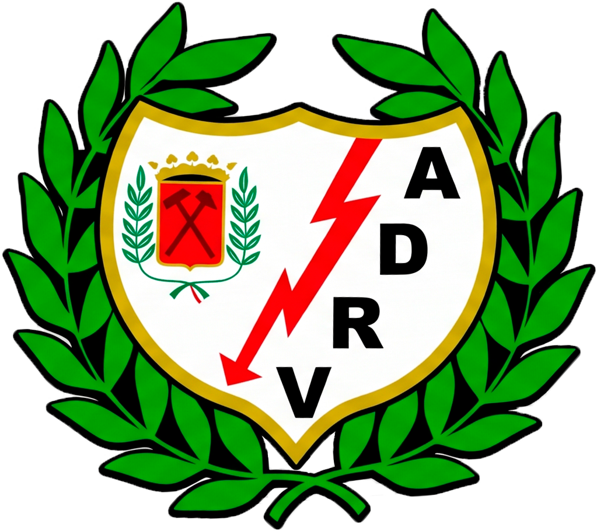
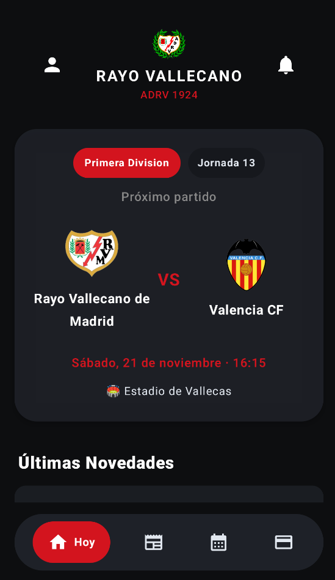
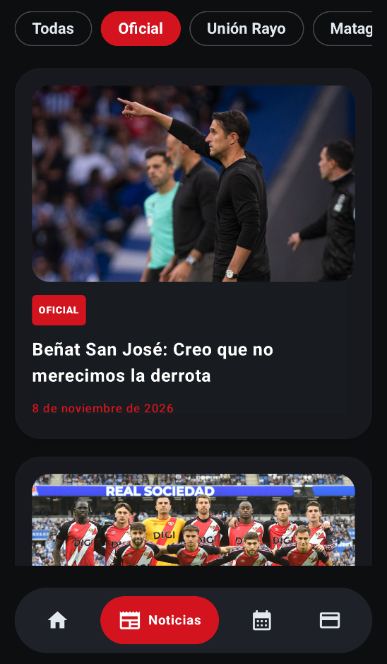
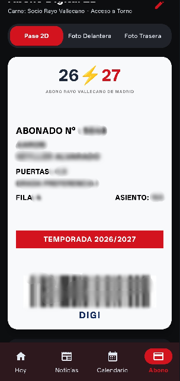

  

  <b>La app definitiva para el rayismo</b> 
  Sigue al Rayo Vallecano en tiempo real — Calendario oficial, clasificación, plantilla, noticias y tu Abono Digital en el móvil

  
  
  
  
  

---

**ADRV** es una aplicación nativa para **Android**, diseñada exclusivamente por y para los aficionados del **Rayo Vallecano**. Construida con tecnologías modernas de Android (Jetpack Compose y Material 3), centraliza todo lo que un rayista necesita en el día a día: desde el acceso rápido a tu carnet digital con código de barras para los tornos de Vallecas, hasta el seguimiento en directo de los partidos, la plantilla oficial y las crónicas de la grada.

> ⚠️ **Nota:** ADRV es un proyecto independiente sin ánimo de lucro creado por un aficionado. No recopila datos personales sensibles y respeta la privacidad del usuario.

---

## ✨ Características principales

### 💳 Abono Digital & Acceso al Estadio
- **Pase 2D Oficial en el móvil:** Genera una réplica digital de alta fidelidad de tu carnet de abonado de la temporada.
- **Escáner Inteligente con ML Kit:** Sube una foto de tu carnet físico y la app extrae automáticamente tu número de abonado, datos y código de barras.
- **Listo para el torno:** Código de barras nativo (Code 128) optimizado para una lectura rápida y sin errores en los accesos de Vallecas.
- **Modo Edición Manual:** Actualiza fácilmente tus datos (puerta, grada, fila, asiento) si lo necesitas mediante un panel de control intuitivo.

### ⚽ Partido de Hoy & Calendario
- **Pantalla de Hoy dinámica:** Toda la información sobre el próximo encuentro del Rayo Vallecano (horario, rival, competición, estadio y árbitro).
- **Escudos oficiales en tiempo real:** Carga automática de escudos y detalles de la competición.
- **Automatización en la nube:** Calendario de partidos sincronizado automáticamente a través de scripts en Python y GitHub Actions.

### 📰 Actualidad y Grada (Noticias)
- **Fuentes oficiales y de afición:** Sigue de cerca la actualidad del club y las crónicas de partidos y viajes.
- **Galerías y galerías de imágenes:** Visualiza crónicas con soporte de contenido multimedia integrado de forma fluida.

### 👥 Plantilla & Club
- **Conoce a los jugadores:** Consulta la plantilla oficial del primer equipo, posiciones, nacionalidades y dorsales.
- **Clasificación al día:** Sigue de cerca la posición del Rayo en La Liga EA Sports jornada a jornada.

---

## 📸 Capturas de pantalla

  
  
  
  
  
  

---

## 🧱 Stack Tecnológico

| Área | Tecnología / Librería |
|------|------------------------|
| **Lenguaje** | Kotlin |
| **Interfaz de Usuario** | Jetpack Compose + Material 3 (con paleta inspirada en los colores del club) |
| **Procesamiento de Imágenes** | Coil 3 |
| **Lectura de Códigos** | Google ML Kit + ZXing (Barcode Generation) |
| **Red y Parseo** | OkHttp + Gson + Jsoup |
| **Automatización** | Python + GitHub Actions (para sincronización de datos y JSONs) |

---

## ⚙️ ¿Cómo funciona la sincronización de datos?

El repositorio utiliza **GitHub Actions** combinado con scripts de Python (`update_matches.py`, etc.) que consultan de forma automatizada las fuentes de datos oficiales y de la comunidad. Esto genera archivos estructurados (`matches.json`, `news.json`) alojados directamente en la rama principal, permitiendo que la app de Android obtenga información actualizada al instante sin sobrecargar servidores externos.

---

## 📥 Instalación

1. Dirígete a la sección de **[Releases](https://github.com/Aaronnn17/ADRV/releases)** de este repositorio.
2. Descarga el archivo APK de la última versión disponible (`ADRV.apk`).
3. Instálalo en tu dispositivo Android (es posible que debas permitir la instalación desde orígenes desconocidos).

---

## 🤝 Contribuir

¡Las contribuciones, ideas y reportes de errores son totalmente bienvenidos! Si quieres proponer mejoras para la app ADRV, siéntete libre de abrir un issue o enviar un pull request.

## ⚖️ Aviso Legal

ADRV es una aplicación no oficial creada por un aficionado del Rayo Vallecano de Madrid. Los logotipos, nombres de equipos y datos de competiciones pertenecen a sus respectivos propietarios y se utilizan únicamente con fines informativos y recreativos para la comunidad rayista.
